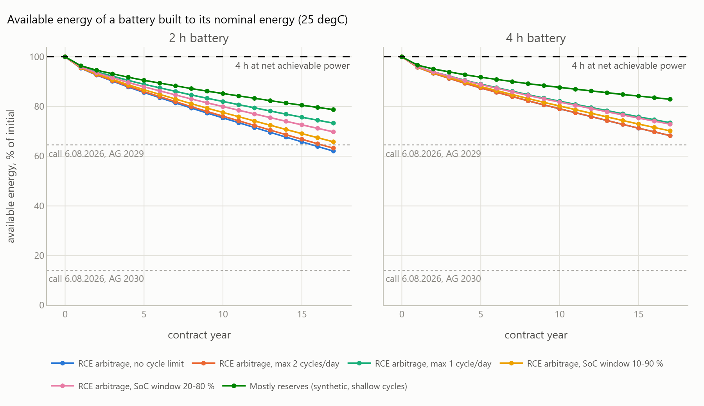
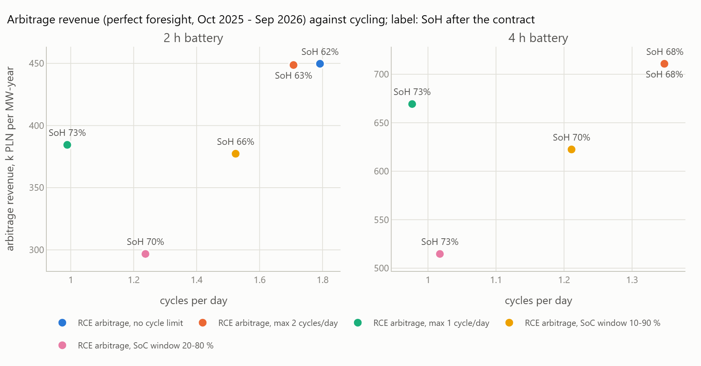
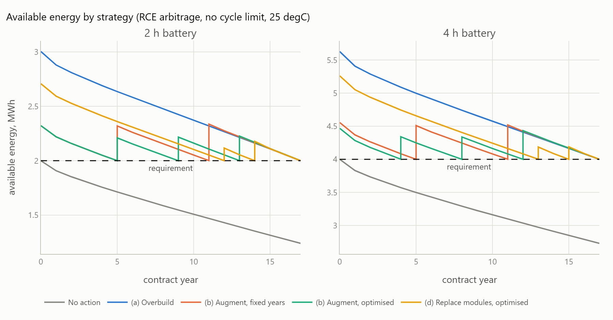
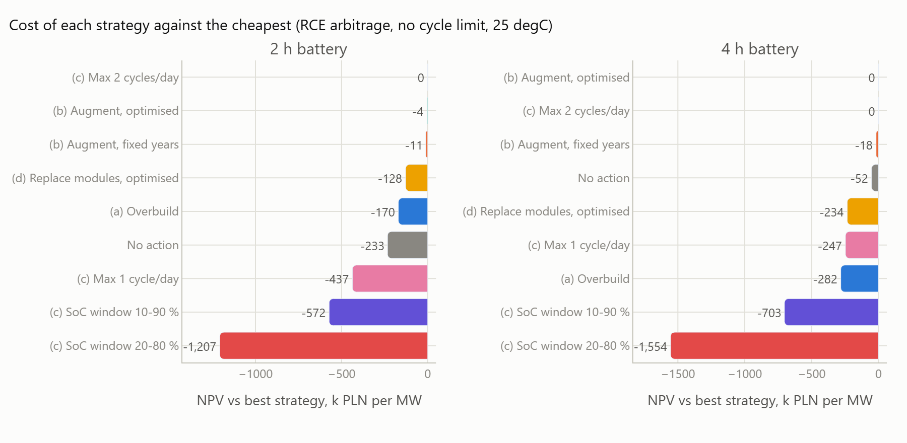
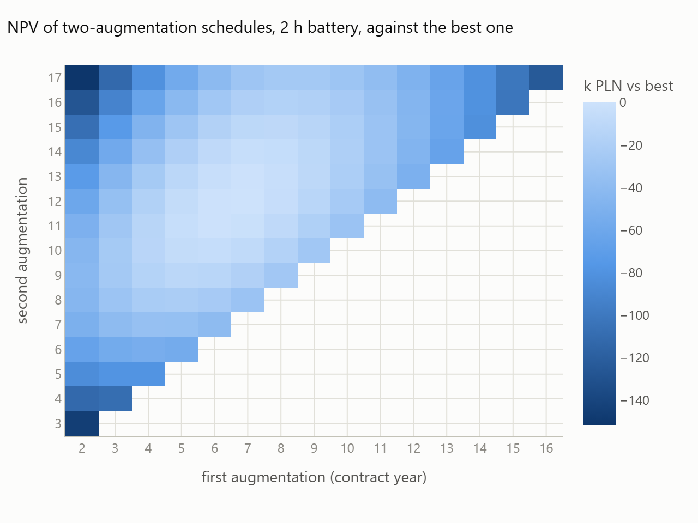
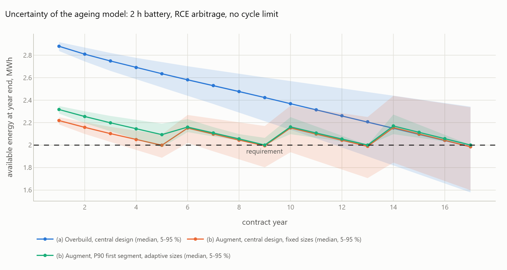
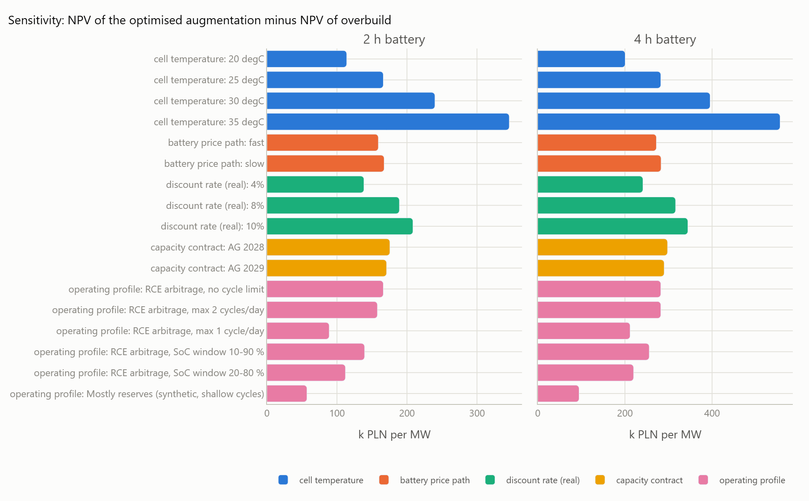
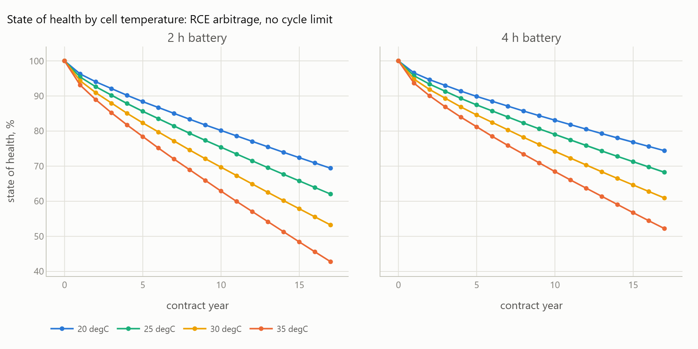
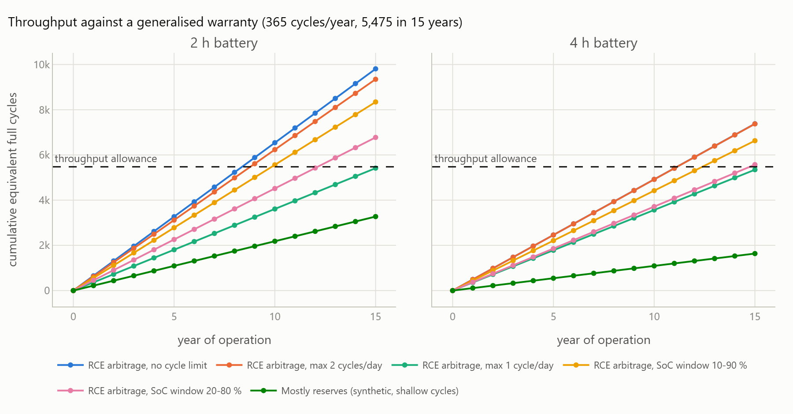
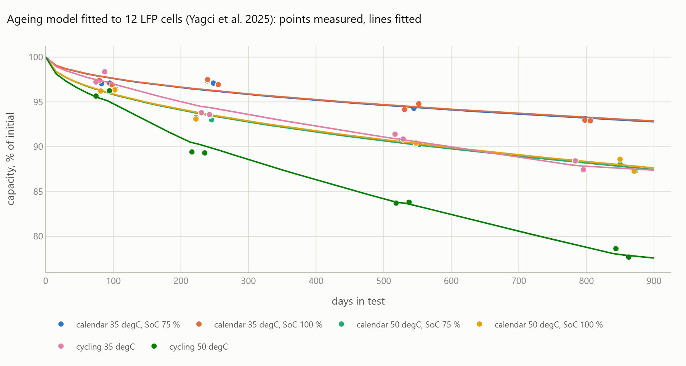

# Keeping an ageing battery in the Polish capacity market

[](https://github.com/kwwaleszczynski-del/bess-capacity-augmentation/actions/workflows/ci.yml)

Most batteries come to Poland with a capacity-market contract of 17 years. Lithium iron phosphate (LFP) cells lose
capacity every year, from calendar ageing alone and faster with every cycle, so a battery that just meets its
obligation at the start does not meet it for long. For an asset manager the questions are when the available energy
falls below what the obligation requires and which way of keeping it there is cheapest: build more energy at the
start (overbuild), add modules later (augmentation), cycle less, or replace modules.

This project answers them for a 1 MW battery with 2 h and 4 h of energy on open data: an LFP ageing model fitted to
the checkup data of twelve stationary-storage cells (Yagci et al. 2025, CC BY 4.0), operating profiles from optimal
arbitrage on PSE's 15-minute RCE prices (October 2025 - September 2026) and a synthetic reserve profile, the
capacity-market rules as published in the law and the auction results, and battery costs from IRENA and NREL. All
assumptions are in [`config/assumptions.toml`](config/assumptions.toml); the interactive dashboard is
[`docs/index.html`](docs/index.html) (GitHub Pages: https://kwwaleszczynski-del.github.io/bess-capacity-augmentation/).

## Key results

Base case: AG 2030 contract (KWD 13.39 %, 465.02 PLN/kW/year, 17 years from 2030), cell temperature 25 degC, real
discount rate 6 %, NREL mid battery-price path, NPV per MW of power in thousands of PLN (k PLN). The obligation
requirement is the four-hour rule: the energy behind the certified net achievable power, which for a battery of up
to 4 h is its nominal energy.

**1. Without headroom the battery falls short in its first year; headroom only buys time.** Short means below the
four-hour requirement, which is this project's reading of the rules for batteries (to be verified). Against the
energy the longest call so far needed, a battery with an AG 2030 contract is never short, whatever its profile and
temperature (result 2), and the model prices a shortfall as the lost capacity payment of the missing share, not as
a penalty. The available energy of the initial modules after 17 contract years and the first year it is below the
requirement for an initial energy 10, 20 or 30 % above nominal:

| Operating profile | Cycles/day (2 h / 4 h) | Arbitrage revenue, k PLN/MW-yr (2 h / 4 h) | SoH after 17 years (2 h / 4 h) | First year short at +10 / +20 / +30 %, 2 h | same, 4 h |
|---|---|---|---|---|---|
| RCE arbitrage, no cycle limit | 1.79 / 1.35 | 450 / 711 | 62 % / 68 % | 3 / 7 / 11 | 4 / 8 / 13 |
| max 2 cycles/day | 1.71 / 1.35 | 449 / 711 | 63 % / 68 % | 3 / 7 / 11 | 4 / 8 / 13 |
| max 1 cycle/day | 0.99 / 0.98 | 384 / 669 | 73 % / 74 % | 4 / 10 / 16 | 4 / 10 / 16 |
| SoC window 10-90 % | 1.52 / 1.21 | 377 / 622 | 66 % / 70 % | 4 / 8 / 12 | 4 / 9 / 14 |
| SoC window 20-80 % | 1.24 / 1.02 | 297 / 515 | 70 % / 73 % | 4 / 9 / 14 | 4 / 10 / 15 |
| mostly reserves (synthetic) | 0.60 / 0.30 | not modelled | 79 % / 83 % | 5 / 13 / never | 7 / 17 / never |

Revenue is the perfect-foresight value; the NPV uses 80 % of it (45-100 % in result 5). The revenue-maximising
schedule cycles 1.8 times a day; a cap at two cycles costs it 0.2 % of the revenue (2 h) and nothing for 4 h, a cap
at one cycle 15 % and 6 %. Calendar ageing alone takes 3.1 % in the first year and 13 % in 17 years at 25 degC, the
floor every profile pays.




**2. The call requirement depends on the contract vintage.** KWD is one value for every battery, but it changed
from 95 % (AG 2028) to 61.30 % (AG 2029) and 13.39 % (AG 2030). To deliver its obligation through a call like the one
of 6 August 2026 (five hours, 4.21 MWh per MW of obligation), a battery needs 100 % of its nominal energy under an
AG 2028 contract, 64.5 % under AG 2029 and 14.1 % under AG 2030. Without headroom and with the revenue-maximising
profile, an AG 2028 battery is short from the first year, an AG 2029 battery of 2 h from year 16 (year 13 at 30 degC,
year 10 at 35 degC) and a 4 h one only above 25 degC (year 16 at 30 degC, 12 at 35 degC); an AG 2030 battery never.
The penalties at stake are small, though: in a year with the three calls of 2026, the unit rate of 6 864 PLN/MWh
costs an AG 2028 battery of 2 h without headroom 6.6 % of its capacity payment at the end of the contract, because
calls are rare and short. What makes headroom worth having is mostly the arbitrage revenue the energy earns.

**3. Optimised augmentation, with or without a cap at two cycles a day, is the cheapest way to stay compliant;
overbuild costs 166-282 k PLN per MW more.** Revenue-maximising arbitrage at 25 degC, every strategy compared with
the optimised augmentation:

| Strategy | 2 h: plan | 2 h: NPV vs (b) opt. | 4 h: plan | 4 h: NPV vs (b) opt. |
|---|---|---|---|---|
| (b) augmentation, optimised | 2.32 MWh, +0.21 / +0.22 / +0.23 MWh in years 6 / 10 / 14 | 0 (NPV 1 752) | 4.47 MWh, +0.34 / +0.34 / +0.43 MWh in years 5 / 9 / 13 | 0 (NPV 2 897) |
| (b) augmentation in years 6 and 12 | 2.32 MWh, +0.32 / +0.34 MWh | -7 | 4.56 MWh, +0.51 / +0.52 MWh | -18 |
| (c) max 2 cycles/day, with its best plan | augmentation, 0.62 MWh added | +4 | same as (b) | 0 |
| (c) max 1 cycle/day | augmentation, 0.37 MWh added | -434 | augmentation, 0.88 MWh added | -247 |
| (c) SoC window 10-90 % | augmentation | -568 | augmentation | -703 |
| (d) module replacement, optimised | 2.71 MWh, 16 % and 26 % of the modules replaced in years 13 / 15 | -124 | 5.26 MWh, 15 % / 16 % in years 14 / 16 | -234 |
| (a) overbuild | 3.00 MWh (+50 %) | -166 | 5.63 MWh (+41 %) | -282 |
| no action | 2.00 MWh, energy and obligation fall | -229 | 4.00 MWh | -52 |

Augmentation buys about as much energy as overbuild in total (2.97 vs 3.00 MWh for 2 h), but later, when it is
cheaper and discounted, and the added modules start young. Replacing modules needs no extra space, but every kWh
bought only gains the difference to the old module's state of health. A cap at two cycles a day gives up 0.2 % of
the revenue of a 2 h battery and saves slightly more in augmentation (+4 k PLN, a tie at this precision); tighter
restrictions slow the ageing but give up more revenue than the augmentation they save. A fourth augmentation adds
nothing (2 h) or 5 k PLN (4 h). For a 4 h battery under AG 2030, doing nothing is only 52 k PLN worse: the obligation
is small, and a 4 h battery that has faded to 2.7 MWh still earns 79 % of the arbitrage revenue of a full one (89 %
on average over the contract). With a capture rate of 60 % or less, doing nothing comes out ahead (result 5).





**4. Under uncertainty augmentation is worth even more.** Over 500 samples of the ageing parameters and the cell
temperature, a design on the central parameters falls short in at least one year with a probability of 52-56 %.
Overbuild for a 90 % chance of compliance needs 3.39 instead of 3.00 MWh (2 h) and 6.21 instead of 5.63 MWh (4 h),
which costs 205 and 315 k PLN of expected NPV. Augmentation needs the margin only until the first augmentation
(2.42 instead of 2.32 MWh) and sizes every augmentation for the capacity it measures, so the same 90 % costs almost
nothing (+1 and -6 k PLN). At the 90 % level augmentation is ahead of overbuild by 358 k PLN (2 h) and 578 k PLN
(4 h). This assumes an operator who knows the future ageing rate once the battery has run for a few years, an
optimistic bound.



**5. Sensitivity.** For the revenue-maximising profile the optimised augmentation stays ahead of overbuild, module
replacement and no action in every case below ((c) is evaluated in the base case only), except for a 4 h battery
with flat battery prices (high-cost path: no action is 111 k PLN better), a discount rate of 8-10 % (8 and 54 k PLN)
or a low capture rate (see below). Its advantage over overbuild grows with temperature, from 114 k PLN (20 degC) to
346 k PLN (35 degC) for 2 h and from 201 to 556 k PLN for 4 h: at 35 degC the SoH of a 2 h battery after 17 years
falls to 43 % (69 % at 20 degC). The price path matters less than expected (159 k PLN with the low-cost path,
167 k PLN with the high-cost path, 2 h), because it lowers the price of the initial build as well. A higher discount
rate favours augmentation (209 k PLN at 10 %), the vintage barely changes it (176 k PLN for AG 2028). For the
reserve profile, whose revenue is not modelled, no action is the cheapest, as compliance then only protects a small
capacity payment.




**Capture rate.** The NPV assumes the battery earns 80 % of the perfect-foresight arbitrage revenue. Two companion
projects bracket that number. The median of the 40 grid batteries of 20 MW or more with a full year of data in
Australia's NEM earned 45 % of the perfect-foresight energy revenue for the capacity it offered from October 2025
to September 2026 (38 % against its registered capacity;
[nem-battery-behaviour](https://github.com/kwwaleszczynski-del/nem-battery-behaviour)). A 1 MW / 2 MWh battery
that plans each day on its own price forecast before the day-ahead gate closure earned 83 % of perfect foresight in
a walk-forward backtest of 865 days on Polish day-ahead (SDAC) prices, not the RCE prices used here (80 % since the
switch to 15-minute products; [pl-bess-paper-trading](https://github.com/kwwaleszczynski-del/pl-bess-paper-trading)).
The two numbers measure different things. The NEM figure is what real operators earned on the capacity they
offered, in a five-minute market whose revenue sits in rare price spikes that are expensive to miss: they cycled
less than the benchmark and, the larger part, traded at worse times, partly because they hold energy back against
spikes and for hedge contracts that are not in the public data. The 83 % is one strategy optimised for one auction:
a day-ahead schedule only has to rank the next day's quarter-hours, and the backtest settles it as a price-taker at
the clearing prices of that auction, without imbalance, fees or outages. The 80 % of the base case is close to what
such a strategy reaches on paper; a real asset with outages, fees and imbalance earns less, and the NEM median shows
how far real operation can fall below it. NPV in k PLN per MW (2 h / 4 h), base case otherwise:

| Capture rate | NPV of (b) optimised | No action vs (b) | (c) max 2 cycles/day vs (b) | (c) max 1 cycle/day vs (b) | (a) overbuild vs (b) | Highest NPV |
|---|---|---|---|---|---|---|
| 45 % | 103 / 290 | +19 / +204 | +7 / 0 | -195 / -95 | -166 / -282 | no action / no action |
| 60 % | 810 / 1 407 | -87 / +94 | +6 / 0 | -297 / -160 | -166 / -282 | (c) max 2 cycles/day / no action |
| 80 % (base) | 1 752 / 2 897 | -229 / -52 | +4 / 0 | -434 / -247 | -166 / -282 | (c) max 2 cycles/day / (b) optimised |
| 100 % | 2 694 / 4 386 | -371 / -198 | +2 / 0 | -571 / -334 | -166 / -282 | (c) max 2 cycles/day / (b) optimised |

Arbitrage revenue is the only cash flow that scales with the capture rate, and every compliant plan keeps its
nominal energy available and earns the full revenue of its profile, so the gaps between overbuild, augmentation and
module replacement do not move. What moves is the value of the energy itself: at 45 % the NPV of the optimised
augmentation falls to 103 k PLN (2 h) and 290 k PLN (4 h), a cap at one cycle a day gives up less, and no action has
the highest NPV for both durations, for 4 h already at 60 %. Below a capture rate between 45 and 60 % (2 h) or
between 60 and 80 % (4 h), letting the battery fade and shedding the missing share of its obligation pays more than
staying compliant, provided the shortfall can be shed at the clearing price as this model assumes (to be verified
against the secondary-market rules and their liquidity). Among the ways to stay compliant, the optimised
augmentation (with or without a cap at two cycles a day) stays first at every rate; only a cap at one cycle a day
moves up, for 4 h ahead of module replacement and overbuild at 60 % and below.

**6. The revenue-maximising strategy breaks a typical warranty in its first year.** Against a generalised warranty
of 15 years with 365 equivalent full cycles a year (5 475 in total), an average SoC of at most 50 % and about 25 degC:

| Profile | Cycles a year on the initial energy (2 h / 4 h) | Allowance used up in year (2 h / 4 h) | Average SoC (2 h / 4 h) | SoH after 15 years (2 h / 4 h) |
|---|---|---|---|---|
| RCE arbitrage, no cycle limit | 654 / 492 | 9 / 12 | 49 % / 52 % | 66 % / 71 % |
| max 1 cycle/day | 361 / 357 | kept | 52 % / 53 % | 76 % / 76 % |
| SoC window 20-80 % | 452 / 371 | 13 / 15 | 49 % / 50 % | 73 % / 75 % |
| mostly reserves | 218 / 109 | kept | 49 % / 50 % | 81 % / 84 % |

The revenue-maximising profile exceeds the annual cycle limit from year 1 and uses up the 15-year allowance in year
9 (2 h); its SoH after 15 years (66 %) is below a 70 % guarantee it would no longer be covered by. The one-cycle cap
keeps the throughput but holds the battery at an average SoC above 50 %, the other common condition. Only the
reserve profile keeps every limit. Warranty terms are confidential and differ by supplier; these are generalised
from public material (see Method).



All numbers are in `results/`: `profiles.csv`, `compliance_years.csv`, `call_exposure.csv`, `strategies.csv`
(every strategy, profile, temperature and scenario), `capture_sensitivity.csv`, `strategy_paths.csv`,
`schedule_grid.csv`, `risk.csv`, `warranty.csv`, `aging_fit.json`.

## Capacity-market rules used

The rules below are read from the consolidated Capacity Market Act (Dz.U. 2025 poz. 610), the regulation on the
performance of the obligation (Dz.U. 2024 poz. 1389), the auction parameter regulations and the published auction
results, as of 22 October 2026. They change often and the reading of some of them for batteries is this project's
interpretation, not an official position: **verify them before any use; this is not legal advice.**

| Rule | Value used | Source |
|---|---|---|
| Contract length of a new unit | 17 years: 15 delivery periods for capex of at least 2 400 PLN/kW of net achievable power, plus 2 for emissions of at most 450 kg CO2/MWh (grid-charged storage: emission factor 0) | Act art. 25 ust. 4-5, art. 3 ust. 3; parameter regulations par. 8 |
| Net achievable power | the power sustained for at least 4 consecutive hours, so for a battery $`P_\text{net} = \min(P, E / 4\,\text{h})`$ (the minimum is this project's reading) | Act art. 2 ust. 1 pkt 19-20; Capacity Market Rules 6.3.2.5, 7.4.2.1 pkt 8 |
| Obligation | at most $`P_\text{net} \times \text{KWD}`$ | Act art. 19 ust. 1 |
| KWD of batteries | one value for every duration: 95.00 % (AG 2028), 61.30 % (AG 2029), 13.39 % (AG 2030) | Dz.U. 2023 poz. 1561, 2024 poz. 1154, 2025 poz. 1066, par. 10 |
| Clearing price | 244.90 (AG 2028), 264.90 (AG 2029), 465.02 (AG 2030) PLN/kW/year | URE and PSE results |
| Call periods | full hours 07-22 on working days, at least 8 h notice; so far 16 hours on 5 days, the longest on 6 August 2026 (17-22 h), whose hourly obligation shares add up to 4.21 MWh per MW of obligation | Dz.U. 2024 poz. 1389 par. 6; PSE, okresy przywołania |
| Penalty | undelivered MWh x 6 864.30 PLN/MWh (2026 rate), at most 2 x obligation x clearing price a year | Act art. 59; URE Informacja 71/2025 |
| Demonstration and test | one hour a quarter at the full obligation | Act art. 67 |
| Secondary market | obligations can be transferred to another unit ahead of the delivery period | Act art. 48 |

No main auction is scheduled after the one for delivery in 2030 (Act art. 29 ust. 3); the base case is a battery with
an AG 2030 contract, AG 2028 and AG 2029 contracts are sensitivities.

## Method

### 1. Operating profiles

A 1 MW battery with 2 h and 4 h of energy at the connection point (round-trip efficiency 87 %) is operated on the
RCE prices of PSE from 1 October 2025 to 30 September 2026, the first twelve months with true 15-minute prices. Each
day is optimised with perfect foresight as a mixed-integer linear program (HiGHS via SciPy): charge and discharge
power, stored energy, no simultaneous charging and discharging, the day ends with the energy it started with.

| Profile | Rule |
|---|---|
| RCE arbitrage, no cycle limit | the revenue-maximising schedule (a 1 PLN/MWh wear cost only breaks ties) |
| max 2 cycles/day, max 1 cycle/day | the same with a daily discharge cap of 2 or 1 times the energy |
| SoC window 10-90 %, 20-80 % | the same inside a narrower state-of-charge window |
| mostly reserves (synthetic) | activation = fast (3 min) + slow (30 min) Ornstein-Uhlenbeck processes, std 8 % and 12 % of power, with a SoC management that steers back to 50 %: many shallow cycles around mid-SoC |

Each profile's state of charge goes through a rainflow count (ASTM E1049, three-point method) and a SoC histogram.
The arbitrage profiles are also solved for 1-4 h in half-hour steps, which gives the revenue of a battery whose
energy has faded below its nominal value. Revenue in the NPV is 80 % of the perfect-foresight value (an assumed
capture rate; 45, 60 and 100 % as a sensitivity), in real terms, with the twelve months of prices repeated every
year.

### 2. Ageing model

Capacity loss is the sum of a calendar and a cycle term,

```math
Q_\text{cal}(t) = k_\text{cal}\, A(T, E_{a,\text{cal}})\, e^{\gamma (\text{SoC} - 0.5)}\, t^{0.5}, \qquad
Q_\text{cyc} = k_\text{cyc}\, A(T, E_{a,\text{cyc}})\, N_\text{eq}, \qquad N_\text{eq} = \sum_i n_i\, \text{DoD}_i^{\beta}
```

```math
A(T, E_a) = \exp\left(-\frac{E_a}{R}\left(\frac{1}{T} - \frac{1}{T_\text{ref}}\right)\right), \qquad T_\text{ref} = 25\,^\circ\text{C}
```

with rainflow cycles $`i`$ of depth $`\text{DoD}_i`$ (counted 1 or 0.5) and $`t`$ in days (the structure of
Schmalstieg et al. 2014 and Naumann et al. 2018/2020 with the rainflow stress of Xu et al. 2018). When conditions
change, each term is accumulated in virtual time, which is exact for a power law: $`Q^{1/z}`$ grows at the rate
$`k^{1/z}`$.

The parameters are fitted to twelve 180 Ah LFP cells for stationary storage aged for up to 873 days (Yagci et al.
2025): eight stored at 75 % and 100 % SoC at 35 and 50 degC give the calendar term, four cycled at full depth in
35 and 50 degC chambers the cycle term after subtracting the fitted calendar ageing. The fit is reproduced by
`python -m bess_augment fit` from the checkup capacities shipped in `src/bess_augment/resources` (derived from the
Zenodo data, CC BY 4.0) and gives $`k_\text{cal}`$ = 1.64e-3 per day^0.5 at 25 degC, $`E_{a,\text{cal}}`$ = 30.5 +- 5.7 kJ/mol, no
measurable SoC effect between 75 % and 100 % ($`\gamma`$ = -0.06 +- 0.34), $`k_\text{cyc}`$ = 2.1 % per 1 000
equivalent full cycles at 25 degC and $`E_{a,\text{cyc}}`$ = 31.8 +- 9.6 kJ/mol (capacity RMSE 0.53 % and 0.65 %). The same approach and data are used in the companion project
[bess-soc-soh-degradation](https://github.com/kwwaleszczynski-del/bess-soc-soh-degradation).



### 3. Battery as cohorts of modules

The battery is operated as a fixed product: the energy management system dispatches the nominal energy (2 or
4 MWh) and any installed energy above it is headroom. All modules share the relative state of charge, so with an
available energy $`E`$ the cells see the profile compressed by $`r = \min(1, E_\text{nom} / E)`$ around 50 %: cycle
depths times $`r`$, SoC levels $`(1 - r)/2 + r \cdot \text{SoC}`$. Headroom therefore both keeps the energy above
the requirement and slows the ageing. Each cohort (the initial modules, every augmentation, every set of
replacement modules) keeps its own calendar age and cycle count:

```math
E_\text{avail}(t) = \sum_j E_j\, \text{SoH}_j(t)
```

The obligation is met in a year if the available energy at its end is at least the requirement. For a battery of
up to 4 h the four-hour rule makes the requirement equal to the nominal energy, so any fade without headroom is a
shortfall; the shortfall share $`s = 1 - E_\text{avail} / E_\text{req}`$ of the obligation is assumed to be shed
on the secondary market at the clearing price (lost capacity payment). The call requirement
$`E \ge P_\text{obl} \times 4.21\,\text{h}`$ is reported separately for each auction vintage.

### 4. Strategies and the schedule search

| Strategy | What is built and when |
|---|---|
| no action | the nominal energy; the shortfall is paid for and arbitrage revenue falls with the energy |
| (a) overbuild | the energy that stays above the requirement until the end of the contract |
| (b) augmentation, fixed years | new modules in years 6 and 12 |
| (b) augmentation, optimised | the best timing of up to three augmentations |
| (c) restricted operation | the best of (a), (b) and (d) under a restricted profile (cycle cap or SoC window): slower ageing, lower revenue |
| (d) module replacement, optimised | the best timing of up to two replacements of a share of the initial modules (no added space, but every kWh bought only gains its difference to the old module's SoH) |

For a given timing, every action is the smallest that keeps the battery compliant until the next one (bisection on
a vectorised simulation). With falling battery prices and discounting, buying more than needed earlier only costs
more, so the timing is the decision: every timing with up to three actions is enumerated as a tree whose nodes
(the fleet state at an action year) are shared by all timings with the same prefix, and each complete timing is
valued by its NPV. Costs:

| Item | Value | Source |
|---|---|---|
| Battery capex | 138 USD/kWh + 215 USD/kW in 2024 (= 192 USD/kWh for 4 h) | IRENA 2025 (192 USD/kWh in 2024), split with the energy/power structure of Cole et al. 2025 |
| Price path | 4 h system cost relative to 2024: 0.84 in 2030, 0.73 in 2035, 0.66 in 2040 (mid); low and high cost cases as sensitivities | Cole, Ramasamy, Turan, NREL/TP-6A40-93281 (2025), Table 2 |
| Augmentation | energy cost of its year + 10 % + 20 000 PLN per MW and event | assumption (no public figure; Lazard prices augmentation at module cost) |
| Replacement | 50 % of the energy cost of its year (modules) + 15 USD/kWh + 20 000 PLN per MW and event | BNEF stationary pack price 2025 (press release); assumption |
| O&M | 3 USD per installed kWh and year | Lazard LCOS v10.0 (2025), low end, augmentation excluded |
| Exchange rate | 3.7588 PLN/USD | NBP, average 2025 |
| Discount rate | 6 % real (4-10 % as sensitivity) | assumption |

Actions at the start of contract year $`y`$ are bought at the price of the calendar year before; the battery is
built in the year before the first delivery year (2029 for an AG 2030 contract). There is no residual value after
the contract.

### 5. Risk

Ageing parameters are drawn 500 times from the joint normal distribution of the cell fit (with its covariance: the
rate constant at 25 degC and the activation energy are strongly correlated) and the mean cell temperature from
$`N(25, 2^2)`$ degC. Every design made on the central parameters is then run for all samples: with fixed sizes, or
(augmentation) with each augmentation sized for the sample's own ageing, as an operator who measures the capacity
every year would. A design for a 90 % or 95 % chance of compliance takes the quantile of the initial energy the
samples need (to the end of the contract for overbuild, to the first augmentation otherwise).

### 6. Warranty

A generalised warranty (15 years, 365 equivalent full cycles a year and 5 475 in total, 70 % of the initial energy
at the end, average cell temperature of about 25 degC, average SoC at most 50 %, at most 0.5C) is built from
public material: the Tesla Megapack 2 XL datasheet (15 years, extendable to 20), Tesla's annual reports (retention
"up to 80 %" with throughput caps), DNV's review of storage capacity warranties (about one cycle a day, average SoC
below 50 %, 0.25-1C, about 25 degC) and the Volta Battery Report 2025 as reported by ESS News (60-70 % SoH
guarantees on one cycle a day). Actual warranties are confidential and differ by supplier.

## Limitations

- **One cell type.** The ageing model is fitted to one commercial LFP cell at 35 and 50 degC and extrapolated to
  20-35 degC with the fitted activation energies. It has no knee (the accelerated fade some LFP cells show late in
  life), no power fade and no resistance growth; pack effects (cell spread, balancing, the weakest string) usually
  make a pack age faster than a cell. The SoC effect on calendar ageing fitted between 75 % and 100 % SoC is nil, so
  a narrower SoC window helps only through shallower cycles; the depth exponent `beta` cannot be identified from
  full-depth tests and is 1 (energy throughput).
- **Perfect foresight, one price year.** The arbitrage profiles know every price of the day and the twelve months
  from October 2025 are repeated for 17 years. Revenue is scaled by an assumed capture rate of 80 % (45-100 % in
  result 5). Balancing revenue is not modelled, so the reserve profile is valued on capacity payments and costs only
  (the strategy comparison within it is still valid: compliant strategies earn the same).
- **The reserve profile is synthetic**; its throughput (about 220 full cycles a year for 2 h) is an assumption.
- **Capacity-market rules are simplified.** The four-hour reading of the net achievable power for batteries, the
  shedding of a shortfall at the clearing price, the 2026 calls as the design year and no residual value after the
  contract are this project's assumptions. Rules, KWD and prices change from auction to auction.
- **Costs** are global or US figures (IRENA, NREL, Lazard) converted at one exchange rate; there is no public
  figure for the augmentation premium or for replacement labour, both are assumptions. Augmentation is continuous
  (no container granularity), needs no extra grid capacity and fits on the site.
- Modules of different ages are assumed to share the relative state of charge (in practice augmentation is often a
  separate block with its own power conversion).

## Data and sources

| Source | Content | Licence / terms |
|---|---|---|
| PSE, [API raporty](https://api.raporty.pse.pl), endpoint `rce-pln`, downloaded 22.10.2026 | RCE, 15-minute prices, Oct 2025 - Sep 2026 | free re-use with attribution (PSE BIP, "Ponowne wykorzystywanie informacji sektora publicznego"); processed here: arbitrage schedules and revenue derived from the prices |
| M. C. Yagci, O. Richter, R. Behmann, W. G. Bessler, research data, [Zenodo 10.5281/zenodo.22939281](https://doi.org/10.5281/zenodo.22939281) (v1.1; paper: J. Energy Storage 124, 116774, 2025, https://doi.org/10.1016/j.est.2025.116774) | checkup capacities of 12 LFP cells; the 50 A discharge capacities derived from them are shipped in `src/bess_augment/resources` | CC BY 4.0 |
| Capacity Market Act, Dz.U. 2025 poz. 610; Dz.U. 2024 poz. 1389; Dz.U. 2023 poz. 1561, 2024 poz. 1154, 2025 poz. 1066; PSE Capacity Market Rules (version in force from 1.11.2026); URE and PSE auction results; URE Informacja 71/2025; PSE call periods page | rules, KWD, prices, penalty rate, calls | public documents |
| IRENA, Renewable Power Generation Costs in 2024 (2025) | battery capex 2024 | public report |
| W. Cole, V. Ramasamy, M. Turan, Cost Projections for Utility-Scale Battery Storage: 2025 Update, NREL/TP-6A40-93281 | capex structure and projections | public report |
| Lazard, LCOE+ (June 2025) | O&M, augmentation convention | public report |
| BloombergNEF press release 09.12.2025 | stationary pack price | press release |
| NBP, table A | USD/PLN 2025 average | public data |
| Tesla Megapack 2 XL datasheet; Tesla 10-K 2016 and 2019; DNV (2021); ESS News on the Volta Battery Report 2025 | warranty terms | public documents |

Only derived numbers and charts are published here; the price data are downloaded by `fetch` into `data/`, which
is not part of the repository. None of the data providers is responsible for this analysis.

## Run it

```bash
python -m venv .venv
.venv/Scripts/pip install -e ".[dev]"        # .venv/bin/pip on Linux/macOS
pytest -q
python -m bess_augment fetch                 # RCE prices from the PSE API (about 1 MB)
python -m bess_augment run --jobs 8          # profiles (about 20 min on 8 cores), strategies, risk, charts
```

`run` writes `results/`, the PNG charts in `docs/img/` and the dashboard `docs/index.html`; `--reuse-analysis` redraws
charts and reruns the risk step from the cached analysis. All assumptions are in `config/assumptions.toml`
(`--config` for another file).

```
src/bess_augment/
  pse_api.py       RCE through pse-opendata (monthly Parquet cache)
  dispatch.py      daily arbitrage MILP, synthetic reserve profile
  rainflow.py      rainflow cycle counting
  aging.py         ageing model, profile stress, fit to the cell data
  fleet.py         cohorts of modules, constant-energy operation, bridging to a requirement
  strategies.py    strategies and the schedule search
  economics.py     cash flows and NPV
  risk.py          Monte Carlo of the ageing parameters, adaptive augmentation
  warranty.py      generalised warranty checks
  config.py        assumptions, capacity-market requirements
  pipeline.py      analysis steps
  plots.py         charts and dashboard
  cli.py           command line
tests/             synthetic data, no network
```

## Disclaimer

This is an independent analysis on public data. It is not investment, legal or tax advice, and it is not the
position of any company. Capacity-market rules, auction parameters and costs change often and must be verified in
the current documents.

## License

Code: MIT. Cell data: CC BY 4.0 (Yagci et al.). Price data: PSE S.A., www.pse.pl.
